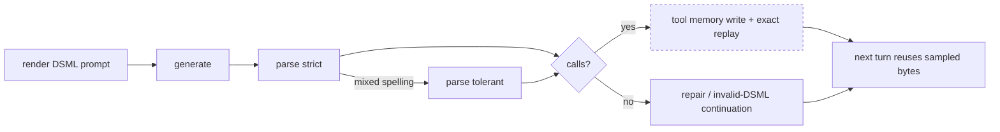

# DS41-DSML-CTR-R1 — DSML tool-call conformance test report

Conformance Test Report (CTR) for the DeepSeek V4.1 Flash (ds41) DSML
tool-call carriage, prepared in the clause structure of ISO/IEC Directives
Part 2 (document structure) with the conformance-testing vocabulary of
ISO/IEC 9646-1 (implementation under test, test purpose, verdict, conformance
test report).

| Field | Value |
| --- | --- |
| Document | DS41-DSML-CTR-R1 |
| Revision | R2 (scope restated: DSML carriage only, client-bound) |
| Date | 2026-10-18 |
| Status | Issued — partial conformance |
| Implementation under test | `ds4-dfm-rs` ds41 serving path, binary `/home/leandro/ds4-dfm-rs/ds4-server` |
| Branch under assessment | R1: `feat/ds41-dsml-complete` base `c942523` (the served binary precedes the line). R2: `feat/ds41-dsml-carriage`, base `c942523` |
| Normative reference | `/data/ds4` at `fc80bd6` |
| Client of record | `/data/open-grok` at `27b48a6`, the configured consumer of this server (clause 2.3) |
| Prepared by | ds4-dfm-rs work session (Spark gate line) |
| Acceptance regime | operator decision 2026-10-18: this Spark conformance suite replaces the rule 19 QA gate for this line |

### Revision history

| Revision | Change |
| --- | --- |
| R1 | Baseline: the conformance requirements, the test purposes and the measured nonconformities of the ds41 carriage as served. Clause 7.1 keeps those measurements unchanged. |
| R2 | Scope restated at the operator's instruction: this line ports DSML carriage only and touches no KV, session or context code. Clause 1.3 replaces R1's "the KV store is in scope" claim, which was the assessor's own reading and not the operator's instruction, and is what admitted an invented checkpoint change into R1's planned phase P1. Clause 3 restates the replay acceptance as prompt byte fidelity and records the arithmetic ceiling that makes a cached-token criterion unreachable without the excluded KV work. Clause 6.3 reserves TP-07..TP-10 to the KV-carrier unit and adds TP-15..TP-18, including the client-bound test purposes. Clause 8 adds NC-07 and NC-08; clause 9 replaces the R1 phase table. NC-07 was raised as an illegal wire value and withdrawn the same day once `generate.rs:3324` was read; clause 8.7 keeps both halves of that record. |
| R3 | Reserved for the post-port re-measurement. |

## 1 Scope

### 1.1 Purpose

This report establishes, by measurement on the reference Spark host, which of
the DSML carriage requirements the ds41 serving path currently satisfies, and
which it does not. The nonconforming requirement list in clause 8 is the
port checklist; clause 9 assigns each nonconformity to a port phase.

### 1.2 Subject of the assessment

The DSML (DeepSeek markup-language) tool-call carriage of the ds41 family on
four client surfaces:

- OpenAI chat completions, non-stream and stream;
- OpenAI responses;
- Anthropic messages;
- the continuation turn of each surface (a second request carrying the tool
  result).

### 1.3 Out of scope

- Kernel, prefill and decode performance outside the DSML path.
- The VQ codec and the Engram tables, covered only as regression witnesses
  (clause 7.3).
- The GLM and Qwen tool syntaxes.
- Model quality of the emitted tool calls (argument correctness beyond the
  assertion of a request-named value).

The KV store is out of scope. R1 declared it in scope as the carrier of the
sampled DSML block; that was the assessor's reading, not the operator's
instruction, and it is retracted here. Operator instruction, verbatim,
2026-10-18: "You need to make a new branch with the DSML port that is missing
and not touch any kv or context etc." A nonconformity whose remedy requires the
checkpoint to cover generated tokens (cached-token replay gain) is therefore
recorded and reserved to a separate unit, not carried by this line. What this
line does assess is what the DSML carriage alone decides: the shape served to
the client, the legality of every value on the wire, the bytes of the next
turn's prompt, the repair contract, and the diagnostics that make those
measurable.

## 2 Normative references

### 2.1 Reference implementation

`/data/ds4` at `fc80bd6`, file `ds4_server.c`. The clauses that state the
requirements assessed here:

| Clause | Reference mechanism | Line |
| --- | --- | --- |
| 2.1.1 | DS41 tag literals (spaced spelling) | 678–683 |
| 2.1.2 | Parse: style detection, invokes, parameters | 6116–6320 |
| 2.1.3 | Repair contract (wrapper only, never an unfinished invocation) | 6707–6774 |
| 2.1.4 | Live stream tracker and payload-vs-structure sampling | 7339–8015 |
| 2.1.5 | Exact sampled DSML replay: tool memory and attach per surface | 10653, 10679, 4272, 4498, 5529 |
| 2.1.6 | Tool-checkpoint suffix and canonicalization | 12800, 12976, 13150 |
| 2.1.7 | Invalid-DSML tool-error continuation | 12260, 12611, 14344, 14446 |
| 2.1.8 | Diagnostics: `--disable-exact-dsml-tool-replay`, `--tool-memory-max-ids`, `--trace` | `ds4_help.c` 378–379, 323 |

### 2.2 Client protocol references

- OpenAI chat completions: `tool_calls` on `choices[].message`, `finish_reason`
  value `tool_calls`, streaming `delta.tool_calls`, `data: [DONE]` terminator.
- OpenAI responses: `output[]` item of type `function_call` with `call_id`,
  `name`, `arguments`; continuation input item `function_call_output`.
- Anthropic messages: `content[]` block of type `tool_use` with `id`, `name`,
  `input`; `stop_reason` value `tool_use`; continuation `tool_result`.

### 2.3 Client of record

`/data/open-grok` at `27b48a6`. The server on `192.168.1.91:8008` is the model
entry `deepseek-v4.1-1017-flash-ds4` in `~/.opengrok/config.toml`
(`base_url = "http://192.168.1.91:8008/v1"`,
`api_backend = "chat_completions"`), so this client is the party the carriage
must satisfy. Its requirements, each read from its source, are normative for
clauses 6.3 and 8:

| Clause | Requirement as the client implements it | Line |
| --- | --- | --- |
| 2.3.1 | Streaming tool calls are assembled by `index`; an omitted index defaults to 0, collapsing distinct calls into one | `chat_completions.rs` 74-77, 199-231, 246-253; `types.rs` 495-499 |
| 2.3.2 | `id` may arrive on any delta (last wins); absent, the call id is the empty string | `chat_completions.rs` 208-211 |
| 2.3.3 | `finish_reason` is a closed enum: `stop`, `length`, `tool_calls`, `content_filter`, `function_call`. Any other value fails chunk deserialization and the stream is a hard error | `types.rs` 373-380; `client.rs` 1988-1995 |
| 2.3.4 | A non-empty tool call forces `stop_reason = ToolCalls`, overriding `length`, so a truncated call is executed rather than reported as truncation | `chat_completions.rs` 257-260; `request_task.rs` 657-662 |
| 2.3.5 | The next request echoes `function.arguments` as the raw string received, never re-serialized; invalid JSON is replaced by `{}` | `conversation.rs` 3516-3527, 3412-3451 |
| 2.3.6 | Unknown fields in a replayed assistant message are tolerated (the client sends a nonstandard `model_id`) | `types.rs` 197-198 |
| 2.3.7 | Reasoning is read from `reasoning_content` only; when thinking is active every assistant message must carry it, even empty | `types.rs` 526-538; `conversation.rs` 3691-3740 |
| 2.3.8 | Tool results are appended in completion order, not call order; the client sets `parallel_tool_calls = true` | `tool_calls.rs` 577-596; `client.rs` 2032 |

Requirement-to-IUT status at R2, each checked against the source:

| Clause | Status | Evidence |
| --- | --- | --- |
| 2.3.1 index on every tool delta | satisfied | `stream.rs:655`, `:676`; reference `ds4_server.c:7270-7285` |
| 2.3.2 a non-empty call id | satisfied | `stream.use_random_ids()` on both routes; reference `:10743` |
| 2.3.3 a closed `finish_reason` enum | satisfied on the ds41 route | `generate.rs:3324` remaps `error` to `stop` before every writer, with the client's own rejection recorded in the comment there. See NC-07, which R2 first raised and then withdrew |
| 2.3.4 a truncated call is executed as complete | risk noted | the same remap turns a lost truncation signal into `stop`; C-02/C-03 measure it (NC-07 restated) |
| 2.3.5 arguments echoed raw | satisfied | `conversation.rs:3516-3527` is client-side; the server-side consequence is the re-render, which is NC-01 |
| 2.3.6 unknown message fields tolerated | satisfied | `parse.rs:1199` region skips unknown keys |
| 2.3.7 `reasoning_content` on every assistant turn | open | assessed by TP-18's second half and the inventory's G-08 |
| 2.3.8 tool results in completion order | open, deferred | reference counterpart `live_tool_call_order` `:10580` applies to Anthropic/Responses only, not the chat path this client uses |

### 2.4 Project-internal references

- `docs/ds41-dsml-port-inventory.md` — static review: the function-by-function
  comparison of the reference and the Rust host (clause 5 of this report is the
  summary of that review).
- `docs/ds41-dsml-reference-matrix.md` — the reference leg: the coverage
  matrix that pairs every requirement in clause 6.3 and every gap in the
  inventory with the case that exercises it, over the operator-supplied V4.1
  encoding oracle `/data/ds4/test/encoding.py`.  Revision R3 folds it in whole
  as this report's reference section, so it is maintained as the third document
  of this line.
- `docs/deepseek41-port-plan.md` — the ds41 port's own record.

## 3 Terms and definitions

- DSML: the tool-call markup the DeepSeek family emits, a block opened by a
  `tool_calls` marker containing one or more `invoke` elements, each carrying
  `parameter` elements with a `string="true|false"` type attribute.
- sampled DSML: the exact byte sequence the model emitted for a tool call,
  including its tag spelling and argument order.
- exact replay: reusing that byte sequence verbatim when the next request's
  prompt is re-rendered, instead of re-rendering the call from client JSON.
- tool memory: the map from tool-call id to sampled DSML, held in RAM and in a
  KV trailer.
- tool checkpoint: the live KV state after a tool-call turn.
- canonicalization: rewriting the live checkpoint so it matches what the next
  request will render.
- continuation turn: a request that carries the result of a previous turn's
  tool call.
- replay gain G (diagnostic, R2): `prefill_cached_tokens(turn 2) −
  prefill_tokens(turn 1)` for one surface and one slot, turn 1 measured
  immediately before turn 2. G counts tokens of the sampled assistant block the
  server reused instead of re-prefilling. On this route G has an arithmetic
  ceiling that no DSML-only change can raise: the engine writes its checkpoint
  once, at the prompt end (`ds4_ds41_draft.inc:804`, `v41_kvreuse_save(&st,
  prompt, np, ...)`), so turn 2 can at most reuse turn 1's prompt, which is what
  the R1 measurements show (`cached = 347 / 351` against turn-1 prompts of the
  same size). G therefore cannot exceed 0 for the assistant block without the
  checkpoint covering generated tokens, which clause 1.3 excludes. G is recorded
  as status, never as this line's acceptance.
- prompt byte fidelity (R2 acceptance for exact replay): the second turn's
  rendered prompt carries the sampled DSML block byte-for-byte as the model
  produced it, instead of a block re-rendered from the client's JSON. This is
  the reference's own criterion: its replay tests assert message bytes
  (`ds4_server.c:19933`, `:19996`), not cached tokens.
- replay miss: an attach that found no sampled bytes for an id and fell back to
  canonical rendering, counted by the reference (`ds4_server.c:10684-10692`).
- legal finish (R2): a `finish_reason` (OpenAI surfaces) or `stop_reason`
  (Anthropic) drawn only from the values the client's closed enum accepts
  (clause 2.3.3).
- IUT: implementation under test.
- TP: test purpose; TC: test case; verdict: pass, fail or inconclusive.

## 4 Abbreviations

DSML, IUT, TP, TC, CTR, KV, SLOT (a server slot holding one live session),
VQ (vector-quantised weights), MTP (multi-token prediction), SSE (Server-Sent
Events).

## 5 Conformance requirements (static review)

Static review is the function-level comparison recorded in
`docs/ds41-dsml-port-inventory.md`: the render side, the parse side (including
the tolerant recovery of loose nested parameters), the live decode tracker, the
tool stream emitters and the SSE projections for all three surfaces are present
in the Rust host. Absent or narrowed, in the same review: the replay attach on
two of three surfaces, the checkpoint canonicalization, the invalid-DSML
continuation, the Responses visible suffix, the in-thinking completion probe,
the two replay flags and the trace surface. Clause 7 measures the
client-visible consequence of these absences.

One candidate nonconformity raised at R2 was withdrawn on the same day: the
finish path was read only as far as the writers, and the remap that guards them
was missed. Clause 8.7 records both the retraction and the smaller defect the
reading did establish, which is measured before it is acted on.

The structural fact that decides the replay requirements: the reference serves
ds41 on the shared session path, so a `ds4_session` exists for it and every
session-addressed mechanism applies (`ds4_server.c:15981`, syntax at `:1218`,
render at `:3366`/`:3438`). The Rust host declares ds41 a no-session engine
(`crates/ds4-server/src/generate.rs:144`) and dispatches it to a push route
whose own documentation lists what it drops (`generate.rs:3019-3028`).

Dashed: the stages the measured nonconformities fall in.

## 6 Test purposes, methods and instrumentation

### 6.1 Instrumentation

| Item | Value |
| --- | --- |
| Test suite (ATS) | `tests/spark/dsml_conformance.sh` |
| Means of testing | `curl` and `jq` against the served HTTP surface; no in-process hooks |
| Execution host | analysis host, over the LAN to the Spark |
| IUT host | `gx10-e1d2` (Spark), `192.168.1.91`, port 8008 |
| Evidence | per-probe request and response bodies, `results.tsv`, `header.txt` |

### 6.2 Method rules

1. Every probe carries a unique reference token inside the user text, so a
   cached-token count cannot be attributed to another probe's session.
2. Replay probes are pairs: turn 1 immediately followed by turn 2 on the same
   slot. A turn 2 separated from its turn 1 by another request is not a valid
   measurement of replay.
3. Verdicts are mechanical (`jq` expressions); the observed values are recorded
   verbatim in `results.tsv`.
4. Regression probes (plain-text KV reuse, temperature-0 determinism) are
   outside DSML by construction; their purpose is to detect collateral damage to
   the VQ/KV path.

### 6.3 Test purposes

| TP | Requirement | Method | Pass criterion |
| --- | --- | --- | --- |
| TP-01 | R-01 OpenAI chat serves one DSML call as `tool_calls` | A-01 | `finish_reason=tool_calls`, name `get_weather`, `arguments.city = Stockholm` |
| TP-02 | R-02 typed parameters survive as JSON types | A-02 | `arguments.seconds` is a JSON number |
| TP-03 | R-03 two invokes in one block | A-03 | two `tool_calls` |
| TP-04 | R-04 streaming carries the call | A-04 | a `tool_calls` delta and `finish_reason=tool_calls` |
| TP-05 | R-05 Anthropic serves `tool_use` | A-05 | `toolu_` id, name, input object, `stop_reason=tool_use` |
| TP-06 | R-06 Responses serves `function_call` | A-06 | one item with `call_id`, name, arguments |
| TP-07 | R-07 chat turn 2 reuses the sampled block | B-01 | RESERVED to the KV-carrier unit (G > 0). Clause 3 proves the ceiling; recorded here, not scored |
| TP-08 | R-08 replay survives a differently spelled client echo | B-02 | RESERVED as TP-07; recorded |
| TP-09 | R-09 Anthropic turn 2 reuses the sampled block | B-03 | RESERVED as TP-07; recorded |
| TP-10 | R-10 Responses continuation reuses the sampled call | B-04 | RESERVED as TP-07; recorded |
| TP-11 | R-11 a cut block is not served as assistant content | C-01 | a call is recovered, or no raw DSML markup in content |
| TP-12 | R-12 replay and trace diagnostics are available | static, flags | all three flags advertised by `--help` |
| TP-13 | R-13 plain-text KV reuse intact | D-01 | second read reuses a prefix |
| TP-14 | R-14 determinism witness reproducible | D-02 | two calls identical; witness hash recorded |
| TP-15 | R-15 exact replay reaches every chat-shaped surface (2.3.5) | B-01, B-02, B-03, B-04 with `--trace` | turn 2's traced prompt carries the sampled DSML block verbatim on chat, Anthropic and Responses |
| TP-16 | R-16 the replay path has a kill switch | B-01 with `--disable-exact-dsml-tool-replay` | switch on: sampled bytes in the traced prompt; switch off: the canonical re-render |
| TP-17 | R-17 a cut turn keeps its truncation signal and a legal finish (2.3.3, 2.3.4) | C-01, C-02, C-03 | every `finish_reason` inside the client's closed enum (holds on main: `generate.rs:3324`), and a turn cut inside its block reports `length`; the change lands only if the probe shows the signal is lost |
| TP-18 | R-18 the client of record completes a real tool loop | client leg (6.4) | one-tool and two-tool turns complete end to end under `/data/open-grok`; the malformed turn does not fail the stream |

### 6.4 Client-of-record leg

TP-18 is measured by driving `/data/open-grok` itself, headless, against the
IUT, using the model entry that names this server (clause 2.3). `curl` probes
establish the wire shape; they cannot establish that the one client that
actually consumes this server survives the turn. The ATS is
`tests/spark/open_grok_leg.sh`, run with the config's model id:

`bin/open-grok -m deepseek-v4.1-1017-flash-ds4 --always-approve
--output-format json --max-turns 4 -p <prompt forcing the tool>`

in a scratch working directory. Its legs: G1 one tool call whose result must
reach the model, G2 two tool calls in one turn (the client sends
`parallel_tool_calls = true` and returns results in completion order), and G3 the
malformed-turn request shape re-run beside the client evidence. The truncation
point of the malformed case is not client-controllable, so TP-17 is scored by the
conformance suite's C-02/C-03 probes; G3 repeats their request shape so the
evidence sits with the client run. The leg consumes the served model and needs
the IUT on port 8008 (clause 6.1), so it runs at the gate, not ad hoc.

## 7 Results

### 7.1 Dynamic results (IUT as served on 2026-10-18 11:36, revision `416d4f5a` build)

Evidence: `docs/evidence/ds41-dsml-gate/iso-baseline-20261018-113636/`.

| TP | Verdict | Observed |
| --- | --- | --- |
| TP-01 | pass | `finish=tool_calls name=get_weather id=call_... args={"city":"Stockholm"}` |
| TP-02 | pass | `arguments={"seconds":90,"label":"tea"} seconds-type=number` |
| TP-03 | pass | `calls=2 names=["get_weather","set_timer"]` |
| TP-04 | pass | `tool_calls lines=8 finish=tool_calls` |
| TP-05 | pass | `id=toolu_... name=get_weather input={"city":"Stockholm"} stop=tool_use` |
| TP-06 | pass | `items=1 name=get_weather call_id=call_... args={"city":"Stockholm"}` |
| TP-07 | **fail** | `turn-1 prompt=347 finish=tool_calls; turn-2 prompt=403 cached=347; replay gain=0 tokens` |
| TP-08 | **fail** | `echo={"city": "Stockholm"}; turn-1 prompt=347; turn-2 prompt=403 cached=347; replay gain=0 tokens` |
| TP-09 | **fail** | `turn-1 prompt=351; turn-2 prompt=407 cached=351; replay gain=0 tokens` |
| TP-10 | **fail** | `turn-1 prompt=347; turn-2 prompt=403 cached=347; replay gain=0 tokens` |
| TP-11 | **fail** | `finish=stop calls=0 raw-DSML lines in content=2` |
| TP-12 | **fail** | 0 of 3 flags advertised (`docs/evidence/ds41-dsml-gate/flags-baseline-20261018.txt`) |
| TP-13 | pass | `first cached=0 second cached=19` |
| TP-14 | pass | `text=[alpha beta gamma] sha16=adf7157c8a5bbb4b` |

### 7.2 Verdict summary

8 pass, 6 fail, 0 inconclusive, of 14 test purposes.

### 7.3 Regression status

TP-13 and TP-14 are outside the DSML path by construction and both pass: the
plain-text KV prefix reuse still reuses (19 of 19 tokens on the second read) and
temperature-0 text is reproducible with witness `adf7157c8a5bbb4b`, which is the
value every later revision must reproduce. No collateral damage to the VQ/KV
path is observed at this revision.

## 8 Nonconformities

### 8.1 NC-01 (TP-07, TP-08, TP-09, TP-10) — no exact DSML replay on any surface

Observed: replay gain is exactly 0 on all four continuations; the second turn's
prompt is 403 (chat, responses) and 407 (Anthropic) tokens with only the turn-1
prompt (347 / 351) reused. The 56-token assistant DSML block is re-prefilled
from the canonical re-render instead of being replayed from the sampled bytes.

Root cause: exact replay is gated to OpenAI chat, non-thinking, with no live
call ids (`crates/ds4-server/src/generate.rs:1350-1360`), and the attach and
remember wiring exists only on the session route
(`generate.rs:4496`, `:4507`, `:4515`, call sites `:2335`, `:2448`, `:2677`).
The ds41 route attaches nothing at all (`generate.rs:3019-3028`).

Why it matters: 56 tokens of re-prefill per tool continuation, on a box whose
measured prefill rate in these runs was 560–600 tokens/s, so roughly 0.1 s
amplified by every tool turn in an agent loop; and, the reason the reference
keeps the sampled bytes at all, the re-render is not what the model produced, so
the prompt and the live frontier drift apart exactly where hidden reasoning is
carried (`ds4_server.c:10679-10737`, `:12800`). The measured gain is the
authoritative number; the wall-time figure is derived, not measured.

### 8.2 NC-02 (TP-11) — a truncated DSML block is served as assistant content

Observed: with the output budget cut mid-block the turn returns
`finish_reason=stop`, `tool_calls` empty, and two raw DSML lines in `content`.
The client cannot execute that, and the turn ends without the model knowing.

Root cause: the ds41 route turns an unterminated tool start into an error
(`generate.rs:3256-3264`) and there is no `continue_after_invalid_dsml`
equivalent (`ds4_server.c:12611`, call sites `:14344`, `:14446`); the model never
sees the tool-error suffix (`:12260`).

### 8.3 NC-03 (TP-12) — replay and trace diagnostics unavailable

Observed: `--disable-exact-dsml-tool-replay`, `--tool-memory-max-ids` and
`--trace` are all absent from the served binary (0 of 3).

Root cause: not ported; the reference documents all three (`ds4_help.c:378-379`,
`:323`).

Why it matters: without the disable flag a replay effect cannot be isolated in
an A/B run, and without `--trace` the rendered prompt bytes cannot be asserted
directly, so replay is measurable only through cached-token accounting.

### 8.4 NC-04 (static, not separately measurable black-box) — checkpoint
canonicalization and the Responses visible suffix

Not directly observable over the HTTP surface; recorded from the static review:
`build_tool_checkpoint_suffix` (`:12800`), `should_canonicalize_tool_checkpoint`
(`:13150`) and `canonicalize_tool_checkpoint` (`:12976`) have no Rust
counterpart, and neither does `build_responses_visible_assistant_suffix`
(`:12821`). Their client-visible effect is the same class as NC-01; they are
listed separately because their port action and their test method differ (they
need a session and a scripted harness, not a black-box probe).

### 8.5 NC-05 (static) — repair contract narrower than the reference

`crates/ds4-server/src/retry.rs:137-225` closes unbalanced parameter and invoke
tags, which the reference refuses (`ds4_server.c:6697-6700`, `:6771-6773`), and
it does not recognise the spaced DS41 tag spelling that the reference tries
first (`:6731`). A cut spaced block is therefore never repaired, and a repair
that should be refused may be applied.

### 8.6 NC-06 (static) — thinking-scope and in-thinking completion

`find_tool_structural_text` (`:5890`) and
`complete_tool_call_inside_thinking` (`:12211`, used at `:14145`) have no Rust
counterpart; the parse-side wrapper-aware scan and the Anthropic live decision
are unverified. Not measured here.

### 8.7 NC-07 (TP-17) — raised at R2 as an illegal wire value, then withdrawn;
restated as a lost truncation signal

Raised: R2 read the ds41 route's `finish = "error"` assignment
(`crates/ds4-server/src/generate.rs:3254-3264`) together with the writers that
emit the finish verbatim (`stream.rs:2352-2367`, `:568-583`) and concluded that
the model-output condition would reach the wire, where the client's closed enum
(clause 2.3.3) fails the stream.

Withdrawn, with the evidence that refutes it: `generate.rs:3324` remaps `error`
to `stop` before every writer on this route, and its comment records that the
client's own rejection ("serialization error: unknown variant `error`", session
2026-10-10 23:17) is why. The R2 reading stopped at the writer and missed the
remap between the two. The illegal-value nonconformity does not exist on main.

Restated, because the same code loses information the reference keeps: the
assignment at `:3254-3264` overwrites a true `length` stop with `error`, which
`terminal_finish` (`retry.rs:455-462`) and `intern_finish` (`tools.rs:2007-2013`)
both carry through, and the remap then flattens it to `stop`. The reference
refuses to do that: `tool_parse_failure_recovery_finish` (`:6776-6784`) keeps
`length` because "callers can distinguish truncation from a completed turn", and
the mapping applies only to genuine parse failures, not to a server error.

Client consequence (2.3.4): a turn cut inside its tool block can be presented as
a completed answer instead of a truncated one, so the agent loop does not know
its output was cut. The reference's own truncation discipline is pinned by
`test_incomplete_tool_call_keeps_stop_reason` (`:19613`) and
`test_tool_parse_failure_returns_recoverable_finish` (`:19517`).

Status: not implemented, and deliberately not implemented before measurement.
The C-02/C-03 probes (which sweep output budgets and report every observed
finish) decide whether the loss is reachable on the served artifact; only then
does a change land, and it would be a named deviation from the engine's
`v41_finish` (server_generate_v41.c:230-235), whose source is absent from this
machine and therefore cannot be read to confirm the engine's own mapping.

### 8.8 Recorded outside this line — the serial route can serve `error`

Found while checking 8.7, and recorded rather than acted on: the serial path
also reaches `finish = "error"` (`generate.rs:2596`, `:2599`) and has no remap,
and the terminal body is written before the settlement decision that reads it
(`serve.rs:1733`). That path serves families other than ds41, so it is outside
this line's scope; it is listed here because it fails the same clause 2.3.3 for
the same client.

## 9 Determination and required port work

The IUT conforms for DSML decoding and client-visible shape on all four surfaces
(TP-01..TP-06), for wire legality on the ds41 route (TP-17's first half, 8.7),
and does not conform for replay (TP-07..TP-10, reserved), recovery and repair
(TP-11, NC-02, NC-05), diagnostics (TP-12, NC-03), checkpoint canonicalization
and the Responses visible suffix (NC-04) and the thinking-scope probes (NC-06).
The port work is phased as follows; each phase names the nonconformities it
closes and the test purposes it must flip, and each is re-verified by re-running
the whole suite so that the pass set can only grow.

| Phase | Scope | Closes | Acceptance |
| --- | --- | --- | --- |
| P0 | Restore the instruments: this report, the inventory, both suites, the client leg of 6.4, and the C-02/C-03 probes | NC-03 (instrument half) | the suites and the client leg run against a served binary and record a baseline |
| P1 | Diagnostics: `--disable-exact-dsml-tool-replay` and `--tool-memory-max-ids` (`ds4_help.c:378-379`, parsed `:15700-15703`), on both the serial engine and the continuous lane | NC-03 | TP-12 passes; TP-01..TP-06, TP-13, TP-14 unchanged (witness identical) |
| P2 | Exact replay carriage on every chat-shaped surface: attach at the request-parse stage and remember at the finish (`:4272`, `:4498`, `:5529`, `:14524`), the scope widened to the reference's rule (`generate.rs:1350-1359`), bounded and gated by P1's switches; the `--trace FILE` instrument (`ds4_help.c:323`, reference write points `ds4_server.c:11976-12017`) lands here because it is what makes the prompt bytes assertable | NC-01 (fidelity half only) | TP-15, TP-16 pass; TP-07..TP-10 recorded and still reserved |
| P3 | The repair contract (`:6707-6774`): refuse unfinished invocations and parameters, supply only the wrapper, accept the spaced DS41 spelling, choose the style by earliest occurrence; the structural scan (`:5894`) only if this exposes it | NC-02 (repair half), NC-05, NC-06 | TP-11 passes; the repair unit test is written failing first |
| P4 | The Responses visible suffix (`:12821`) with `:20386`; the reasoning_content check of 2.3.7; and, if C-02/C-03 show the loss, the truncation-signal deviation of 8.7 | NC-04 (suffix half) | the suffix test passes; the 2.3.7 check and the 8.7 measurement are recorded either way |
| P5 | Per-function verdict, then revision R3 of this report from re-measured results with the evidence pack | — | one row per landed function with reference citation, test, measured before/after and a keep-or-revert verdict |

Reserved, not performed by this line: TP-07..TP-10 (cached-token replay gain),
checkpoint canonicalization, the invalid-DSML in-turn continuation, and the ds41
per-slot session. Each is recorded in the inventory with the reason, and belongs
to a unit that may alter KV state.

## Annex A — Environment record

| Item | Value |
| --- | --- |
| Host | `gx10-e1d2`, `192.168.1.91`, NVIDIA GB10, driver 580.178.04 |
| Memory | 121.6 GiB unified; about 9.9 GiB available with the model resident |
| Server | `/home/leandro/ds4-dfm-rs/ds4-server --cuda -m /mnt/models/ds41-1017/DeepSeek-V4.1-Flash-vq8sh14-q4k-mtpnative.gguf --engram-dir /home/leandro/models/ds41-1017-engram --mtp-mode auto --mem-budget-mb 110000 --host 0.0.0.0 --port 8008 --vision-gguf /mnt/models/ds41-1017/DeepSeek-V4.1-Flash.vision.gguf` |
| Model id | `DeepSeek-V4.1-Flash-vq8sh14-q4k-mtpnative`, context 1048576 |
| Served binary build | branch `fix/glm53-vq-penalties`, commit `416d4f5a` |
| Worktree for this line | `/home/leandro/ds41-dsml` at `c942523`, branch `feat/ds41-dsml-complete` |
| Observation window | 2026-10-18 11:30–11:37 CEST |
| Measured rates | prefill 434–2137 tokens/s, decode 30–46 tokens/s, 2.0–4.0 tokens per step (MTP) |

## Annex B — Evidence index

| Path | Content |
| --- | --- |
| `docs/evidence/ds41-dsml-gate/iso-baseline-20261018-113636/` | results.tsv, header.txt, per-probe request and response bodies (this report's dynamic results) |
| `docs/evidence/ds41-dsml-gate/baseline-lan-20261018-113202/` | first LAN run of the benefit/regression gate (22/22 pass) |
| `docs/evidence/ds41-dsml-gate/flags-baseline-20261018.txt` | R-12 flag check |
| `~/ds41-dsml-gate/out-baseline-20261018-113023` (on the Spark) | loopback run of the benefit gate, independent of the LAN route |
| `tests/spark/dsml_conformance.sh` | the ATS used for clause 7 |
| `tests/spark/dsml_compliance.sh` | benefit and regression gate used for the per-phase deltas |

## Annex C — Traceability

Requirement-to-code traceability (reference function, Rust counterpart or its
absence) is maintained in `docs/ds41-dsml-port-inventory.md`, clause 2 to
clause 4. That document is the static half of this report and is not duplicated
here; where the two disagree, the measured result in clause 7 and the reference
artifact win.
